<a href="https://qianfuv.fun/">
  <picture>
    <source media="(prefers-color-scheme: dark)" srcset="assets/neofetch-dark.svg">
    
  </picture>
</a>

### ⚡ Recently Active

<!-- PROJECTS:START -->

<a href="https://github.com/QianFuv/Yousage"><picture><source media="(prefers-color-scheme: dark)" srcset="assets/repo-Yousage-dark.svg"></picture></a>
<a href="https://github.com/QianFuv/LitRadar"><picture><source media="(prefers-color-scheme: dark)" srcset="assets/repo-LitRadar-dark.svg"></picture></a>
<a href="https://github.com/QianFuv/QianFuv.github.io"><picture><source media="(prefers-color-scheme: dark)" srcset="assets/repo-QianFuv.github.io-dark.svg"></picture></a>
<a href="https://github.com/QianFuv/Miracles-Journey"><picture><source media="(prefers-color-scheme: dark)" srcset="assets/repo-Miracles-Journey-dark.svg"></picture></a>

<!-- PROJECTS:END -->

### 🧰 Tech Stack

<!-- TECH:START -->

<!-- TECH:END -->

<picture>
  <source media="(prefers-color-scheme: dark)" srcset="assets/snake-dark.svg">
  
</picture>

<!-- UPDATED:START -->

auto-updated 2026-10-17 18:03 UTC

<!-- UPDATED:END -->
